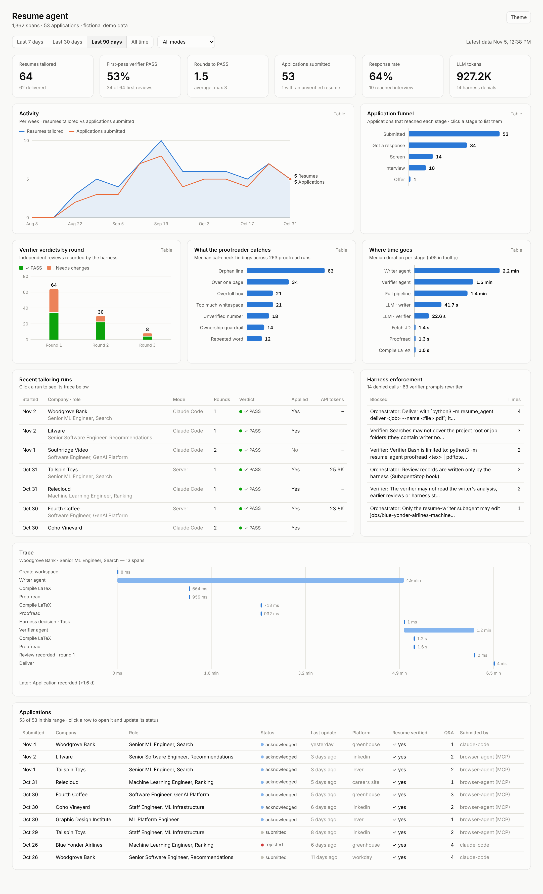
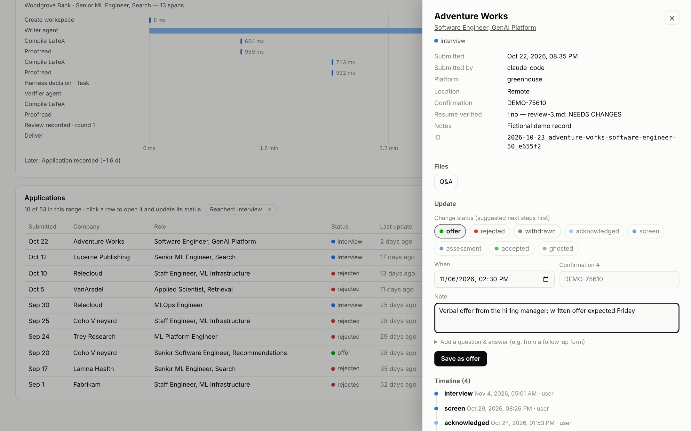

# LaTeX Resume Agent

Tailor a one-page LaTeX resume to a job posting, given just the link. The agent fetches the JD,
maps requirements to evidence from a factual work-history bank, edits the template, compiles it,
proofreads the PDF (mechanically and with an independent visual reviewer), and hands back the result.

It runs two ways on one shared core:

| Mode | Who does the LLM work | Entry point |
|---|---|---|
| **Claude Code** | Claude Code on your plan | `/resume <job-url>` |
| **MCP / A2A server** | the calling agent, or the server with an `ANTHROPIC_API_KEY` | `docker compose up` |

Codex still works too: `AGENTS.md` is the single copy of the rules, and `CLAUDE.md` imports it.

## Your data stays local
Everything personal is gitignored: `profile/` (your fact bank, rules and guardrails), `templates/`
(your LaTeX resume), `jobs/` and `outputs/`. The repo ships a **fictional** example in `examples/`.

```bash
python3 -m resume_agent init     # copies examples/ into profile/ and templates/ (never overwrites)
# then replace them with your own:
#   profile/work_history.md   every fact, metric and ownership note you are allowed to claim
#   profile/rules.md          ownership boundaries, positioning variants, bullet budget, output name
#   profile/guardrails.json   overclaim phrases the proofreader should flag
#   templates/resume_base.tex your one-page LaTeX resume (the visual baseline)
```

Keep a private backup of `profile/` and `templates/` (e.g. a private repo or cloud drive). Git won't.

## Why this structure
The hard part of resume customization is not LaTeX generation. It is repeatedly making the same judgment calls:
- which work facts are strongest for this JD,
- what ownership can be claimed safely,
- which metrics deserve space,
- how to stay within one page without shrinking the layout,
- and whether the compiled PDF still looks good.

The repo turns those decisions into persistent instructions (`AGENTS.md`) and turns everything that
can be checked mechanically into code (`resume_agent/proofread.py`, `profile/guardrails.json`).

## Project structure

```text
AGENTS.md                          Generic rules (shared by Codex, Claude Code, the server)
CLAUDE.md                          Claude Code entry; imports AGENTS.md
.claude/commands/resume.md         /resume slash command (full workflow)
.claude/commands/record-application.md  /record-application: log a submitted application
.claude/agents/resume-writer.md    Writer subagent
.claude/agents/resume-proofreader.md  Verifier subagent (also the server's verifier prompt)
.claude/hooks/resume_harness.py    Hook shim → resume_agent/harness.py (role enforcement)
.claude/settings.json              Tool permissions; profile/ and templates/ are edit-denied
examples/                          Fictional profile + template (tests use these)
profile/            (gitignored)   work_history.md, rules.md, guardrails.json: your private data
templates/          (gitignored)   resume_base.tex: your one-page visual baseline
resume_agent/                      Shared Python core
  jd_fetch.py                        URL → JD (Greenhouse, Lever, Ashby, Workday, LinkedIn, JSON-LD, HTML)
  compile.py                         pdflatex + 1-page check + PNG + log parsing
  proofread.py                       layout / fact / guardrail / hygiene checks
  workspace.py                       jobs/<slug>/ folders
  harness.py                         Claude Code hook policy (writer/verifier separation)
  gate.py                            harness-stamped review records + delivery gate
  applications.py                    submitted-application tracker (applications/, index.md/csv)
  tracing.py                         pluggable tracer: local JSONL (default) | otel | none | module:Class
  dashboard.py, dashboard.html       local dashboard over traces/ + applications/
  demo.py                            fictional demo data generator
  llm_pipeline.py                    server-side writer → proofread → reviewer loop (Anthropic API)
  mcp_server.py, a2a_server.py, server.py   MCP + A2A over one HTTP app
scripts/                           Original shell helpers (still work)
jobs/<slug>/                       One folder per target role
outputs/                           Final PDFs
```

## Local dependencies
- Python 3.11+
- `pdflatex` (TeX Live with `titlesec`, `enumitem`, `fullpage`, `marvosym`)
- Poppler: `pdfinfo`, `pdftoppm`, `pdftotext`
- `pip install -e ".[server,dev]"` (only `requests` is needed for Claude Code mode)

## Mode 1: Claude Code (uses your plan)

```bash
cd latex-resume-agent
claude
> /resume https://job-boards.greenhouse.io/acme/jobs/1234567
```

The command runs a small multi-agent pipeline. The writer and the verifier never share a context:

| Role | Who | Can | Cannot |
|---|---|---|---|
| Orchestrator | the main Claude Code thread | fetch the JD, launch subagents, read `status`, `deliver` | edit `resume.tex` / `analysis.md`, write reviews, copy into `outputs/` directly |
| Writer | `resume-writer` subagent | write `analysis.md` + `resume.tex`, run the mechanical proofread | touch `profile/` / `templates/`, write reviews, deliver |
| Verifier | `resume-proofreader` subagent, **new instance each round** | read the fact bank, rules, JD, PDF, PNG, tex; run `proofread` / `pdftotext` | see `analysis.md`, earlier reviews or harness state; write anything; be messaged again |

Flow: `start` → writer (first pass) → fresh verifier → if NEEDS CHANGES, writer revises from `review-N.md`
→ fresh verifier … (max 3 rounds) → `deliver`.

### Enforced by the harness, not just the prompts
`.claude/settings.json` registers hooks that run `.claude/hooks/resume_harness.py`, a thin shim over
`resume_agent/harness.py`. The hook input's `agent_type` identifies the role.
- **PreToolUse:**
  - role-based write locks on `resume.tex`, `analysis.md`, `review-*.md` and `outputs/`;
  - the verifier is read-only, with a Bash allowlist and no access to writer notes;
  - the verifier's launch prompt is rewritten to just `Job folder: jobs/<slug>/`, so the orchestrator
    can't pass summaries or a suggested verdict, and any `resume` of an earlier agent is stripped;
  - `SendMessage` to an old verifier is blocked.
- **SubagentStart:** maps each subagent to its job, and tells the verifier it is fresh.
- **SubagentStop:** the hook, not an agent, saves the verifier's final reply as `review-N.md`, stamped
  with the verdict and the SHA-256 of `resume.tex`. A reply without a `VERDICT:` line is sent back once.
- **Delivery gate:** `python3 -m resume_agent deliver` copies to `outputs/` only if the latest
  harness-stamped review is a PASS for the *current* `resume.tex`. Any edit after the PASS, or a
  hand-written review file, blocks it. After 3 rounds, `--accept-open-issues` lets you ship anyway.

Edit/Write rules are exact. Bash rules are pattern-based (best effort). If the policy code itself
crashes, calls inside the resume subagents are blocked (fail closed) and the main thread is left alone.
Check the hooks are loaded with `/hooks` after opening the repo (hooks load when a session starts).

The CLI is also usable by hand:

```bash
python3 -m resume_agent start <url> [--slug acme-ml]       # or: start --text-file jd.txt --slug acme-ml
python3 -m resume_agent proofread jobs/acme-ml/resume.tex   # writes proofread.md; exit 1 on errors
python3 -m resume_agent check jobs/acme-ml/resume.tex       # compile + 1 page + PNG only
python3 -m resume_agent status jobs/acme-ml                 # review rounds + delivery gate
python3 -m resume_agent deliver jobs/acme-ml --name Jane_Doe_Acme_MLE.pdf
```

## Mode 2: MCP / A2A server

```bash
cp .env.example .env    # set RESUME_AGENT_TOKEN, optionally ANTHROPIC_API_KEY and PUBLIC_BASE_URL
# profile/ and templates/ are mounted read-only into the container, not baked into the image
docker compose up --build
curl localhost:8080/healthz
```

| Endpoint | Protocol |
|---|---|
| `POST /mcp` | MCP, streamable HTTP (stateless) |
| `GET /.well-known/agent-card.json` | A2A agent card |
| `POST /a2a` | A2A JSON-RPC: `message/send`, `tasks/get` |

All endpoints except health and the agent card require `Authorization: Bearer $RESUME_AGENT_TOKEN`.

### MCP tools
| Tool | Purpose |
|---|---|
| `generate_resume(jd_url \| jd_text, slug?, instructions?)` | Full pipeline on the server and returns the PDF. Needs `ANTHROPIC_API_KEY`. |
| `start_job(jd_url \| jd_text, slug?)` | Fetches the JD and creates a workspace. |
| `get_resume_context(slug?)` | Returns the rules, fact bank, template, guardrails, reviewer checklist, and the job's JD/tex. |
| `write_resume(slug, resume_tex, analysis_md?)` | Saves, compiles and proofreads; returns the report and the rendered page image. |
| `verify_resume(slug)` | Independent verifier in a fresh model call that sees only facts, rules, JD, PDF text and page image (never your analysis). Needs `ANTHROPIC_API_KEY`. |
| `proofread_resume(slug)` / `get_resume_pdf(slug)` / `list_jobs()` / `fetch_job_description(url)` | Helpers. |
| `record_application(...)` / `update_application` / `list_applications` / `get_application` / `get_application_file` | Track submitted applications (see below). |

There are two ways a calling agent can use the server:
- **The caller does the writing (no server key needed).** Use the `tailor_resume` prompt:
  `start_job` → `get_resume_context` → `write_resume` (repeat) → `verify_resume` → `get_resume_pdf`.
  The caller's model writes, and a separate verifier signs off rather than the writer itself.
- **The server does the writing.** Call `generate_resume`. It runs writer → mechanical proofread →
  independent reviewer (the same prompt as the Claude Code subagent, given the rendered PNG) → fix,
  for up to 3 rounds. Models are set by `RESUME_WRITER_MODEL` / `RESUME_REVIEWER_MODEL`.

Example Claude Code client config (`.mcp.json` in another project):

```json
{
  "mcpServers": {
    "resume": {
      "type": "http",
      "url": "https://resume.example.com/mcp",
      "headers": { "Authorization": "Bearer ${RESUME_AGENT_TOKEN}" }
    }
  }
}
```

### A2A
Send a text part with a job URL (any extra text becomes instructions), or a data part
`{"jd_url", "jd_text", "slug", "instructions"}`. The completed task has a `resume.pdf` file artifact and
an `analysis.md` text artifact. Pass `configuration.blocking: false` to get a `working` task back
immediately, then poll `tasks/get`. Server-side generation requires `ANTHROPIC_API_KEY`.

## Tracking submitted applications
After an application is **actually submitted**, record it. Every entry point writes the same local
store, `applications/`, which is gitignored. With Docker, it's mounted from your machine.

```text
applications/
  index.md                 table of every application, newest first (status, company, role, link, verified?)
  index.csv                same, for spreadsheets
  2026-11-06_acme_senior-ml-engineer-search_3f9a2c/
    application.json       record: job, timestamps, resume sha256 + verification, Q&A, status timeline
    resume.pdf             the exact PDF that was submitted
    resume.tex             its source (when it came from a job workspace)
    jd.md                  job-posting snapshot (postings disappear)
    cover_letter.md|.pdf   cover letter, if any
    answers.md             every application question and the answer given
    attachments/           anything else uploaded
```

| From | Record | Update / query |
|---|---|---|
| MCP | `record_application(job_url, slug \| resume_pdf_base64, questions=[{question, answer}], cover_letter_text \| cover_letter_base64, confirmation_id, submitted_at, notes, extra, idempotency_key)` | `update_application`, `list_applications`, `get_application` |
| A2A | data part `{"action": "record_application", ...same fields}` | `{"action": "update_application" \| "list_applications" \| "get_application", ...}` |
| CLI | `python3 -m resume_agent app record --url U --slug S --qa qa.md --cover-letter cl.md` | `app update <id> --status interview --note ...`, `app list`, `app show <id>` |
| Claude Code | `/record-application <url>`, then paste the questions, answers and cover letter | same CLI |

What gets checked and stored at record time:
- **The exact resume:** SHA-256 of the submitted PDF, and whether it matches the generated one for that job.
- **Verification:** the delivery-gate verdict at submission time, so an application sent with an
  unverified resume is flagged in the index.
- **Job details:** company, role and location from the job's `jd.md`. If none is available, the
  posting is fetched (best effort). The platform is detected from the URL.
- **Duplicates:** the same URL already recorded gives a warning. A repeated `idempotency_key` returns
  the existing record, so agent retries are safe.
- **Statuses:** submitted, acknowledged, screen, assessment, interview, offer, accepted, rejected,
  withdrawn, ghosted. Each change is appended to the timeline with a timestamp and a note.

Hooks block agents from editing `applications/` directly. Changes go through the CLI or tools so the
index and hashes stay consistent.

## Tracing and dashboard



*Screenshot generated from fictional demo data (`python3 -m resume_agent demo-data`).*

### Tracing (pluggable)
Every stage emits spans through `resume_agent.tracing`. The backend is chosen with `RESUME_TRACER`:

| Value | Where spans go |
|---|---|
| `local` (default) | JSON lines in `traces/spans-YYYY-MM-DD.jsonl` (gitignored; `RESUME_TRACES_DIR` to move it). The dashboard reads these. |
| `otel` | OpenTelemetry API, with attributes prefixed `resume.`. If the SDK and OTLP exporter are installed (`pip install ".[otel]"`, already in the Docker image) and `OTEL_EXPORTER_OTLP_ENDPOINT` is set, an OTLP/HTTP exporter is configured automatically. Otherwise the host process's provider is used. |
| `none` | Tracing off. |
| `pkg.module:MyTracer` | Your own `resume_agent.tracing.Tracer` subclass. Implement `span(name, attrs)` as a context manager. |

Combine backends with commas. For example, `RESUME_TRACER=local,otel` keeps the local dashboard working
while also exporting to Jaeger, Honeycomb, Grafana and so on.

Spans cover: JD fetch, workspace creation, LaTeX compile, proofread (findings), LLM calls (model, role,
input/output tokens), server generation and verification, review records (round, verdict), delivery,
application record/update, every MCP tool call (server middleware), A2A requests, and harness actions
(denials, verifier prompt rewrites, writer/verifier agent durations).

Spans hold metadata only: ids, timings, counts, verdicts, company/role, model, tokens. They never hold
resume text, JD text or application answers. A broken tracer config falls back to `none` instead of
breaking resume generation.

### Dashboard
```bash
python3 -m resume_agent dashboard --open              # http://127.0.0.1:8050, re-reads traces/ + applications/ on each load
python3 -m resume_agent dashboard --export report.html  # one self-contained offline HTML file
docker compose --profile dashboard up dashboard          # same, from the container volumes

python3 -m resume_agent demo-data --out demo             # fictional data to try it
python3 -m resume_agent dashboard --traces demo/traces --applications demo/applications
```

What it shows:
- **Key numbers:** resumes tailored, first-pass verifier PASS rate, average rounds to PASS,
  applications submitted, response rate, LLM tokens.
- **Activity:** resumes tailored vs applications submitted over time.
- **Application funnel:** submitted → response → screen → interview → offer.
- **Verifier verdicts by round.**
- **What the proofreader catches:** its most common findings.
- **Where time goes:** median and p95 duration per stage.
- **Recent tailoring runs:** click one to see a per-run trace waterfall.
- **Harness enforcement:** denials by role and reason.
- **Applications table.**

**Working with applications.** Clicking a row in the applications table, or a stage in the funnel,
opens a detail panel. It shows the job link, submission time, confirmation number, whether the
resume was verified, the full timeline and every application question with the answer given. It
also links to the exact PDF submitted, the cover letter and the posting snapshot. From the panel you
can **change the status**, with suggested next steps first and an editable timestamp. You can also
add a note, set the confirmation number, or add a question and answer from a follow-up form.



Saving calls the same `applications.update_application` that the CLI, MCP and A2A use, so the
timeline, `index.md` and traces stay consistent no matter where an update comes from. The local
server only accepts edits from its own page:
- it checks the Host header is localhost (against DNS rebinding);
- it rejects cross-origin requests;
- each request needs a per-process token and a JSON body.

It only serves files from inside an application folder. Use `--read-only` to turn editing off.
Exported HTML is always read-only.

| Action | Dashboard | CLI | MCP | A2A (`data.action`) |
|---|---|---|---|---|
| Change status, note, confirmation #, add Q&A | detail panel | `app update <id> --status ... --note ...` | `update_application` | `update_application` |
| Open a record | click a row | `app show <id>` | `get_application` | `get_application` |
| Open its files (PDF, cover letter, posting, Q&A) | links in the panel | `app file <id> [name] [--out f]` | `get_application_file` | `get_application_file` |

Filters for date range and run mode scope everything on the page. Each chart has a table view and a
hover tooltip, and the page follows your OS light/dark setting (with a toggle). It has no
dependencies, makes no network calls and is a single HTML file.

## Proofreading checks
`resume_agent/proofread.py` fails the resume on:
- not exactly one page, or LaTeX errors;
- any number that doesn't appear in `work_history.md` or the template;
- `error` guardrails from `profile/guardrails.json` (e.g. sole-ownership language, claiming work someone else owned);
- LaTeX markup leaking into the PDF text, or an 11pt class change.

It warns on orphan lines, bottom whitespace, squeezed line spacing, overfull boxes, a preamble that
drifted from the template, `warn` guardrails, and repeated words.

## Tests
```bash
python3 -m pytest -q
```

## Recommended human-in-the-loop step
Before submitting, review only two things:
1. whether any bullet overstates ownership;
2. whether the selected emphasis matches the role you actually want.
